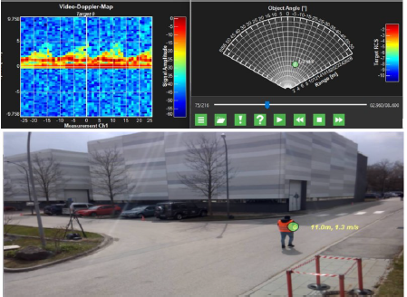

# micro-doppler-classification
Deep learning-based classification of pedestrians, cars, and cyclists using 24 GHz radar micro-Doppler signatures. Compares CNN and CNN-LSTM models, normalization strategies, and range-based power compensation using five-fold cross-validation.

# Micro-Doppler Radar Classification

## Overview

This project investigates deep learning methods for classifying pedestrians, cars, and cyclists using micro-Doppler signatures collected with a stationary 24 GHz automotive radar. The dataset contains labeled 1.5-second radar recordings, represented as micro-Doppler maps, along with radar detection metadata that can be explored as additional features.

The project implements a PyTorch-based classification pipeline and compares different model architectures, input representations, and normalization strategies to investigate their impact on classification performance.

## Objectives

- Classify three road-user categories: **pedestrians, cars, and cyclists**.
- Compare CNN and CNN-LSTM architectures for micro-Doppler-based classification.
- Investigate the effect of range-based power compensation on model performance.
- Compare data normalization strategies while maintaining consistent cross-validation splits.
- Evaluate model performance using accuracy, loss, per-class metrics, confusion matrices, and ROC-AUC curves.

## Experimental Comparisons

### 1. Model Architecture: CNN vs. CNN-LSTM

Two neural network architectures are implemented:

- **CNN:** Extracts spatial features from micro-Doppler maps using convolutional layers, ReLU activations, max pooling, dropout, and fully connected layers. This model learns discriminative patterns directly from the time-Doppler representation.
- **CNN-LSTM:** Applies a shared convolutional feature extractor to individual time steps and uses an LSTM to learn temporal dependencies across the resulting feature sequence. This architecture aims to capture both local Doppler patterns and changes over time.

The `radar_model` variable selects the architecture:

- `cnn` — standard convolutional neural network.
- `cnn-lstm` — time-distributed CNN followed by an LSTM.

### 2. Original vs. Range-Compensated Micro-Doppler Data

The notebook investigates whether range-based power compensation improves classification performance by reducing the influence of target distance on the radar signal magnitude.

Two input configurations are considered:

- **Original data:** Uses the extracted micro-Doppler maps without range compensation.
- **Range-compensated data:** Applies the correction

  \[
  S_{\mathrm{comp}} = S + 40\log_{10}(R)
  \]

  where \(S\) is the original signal representation and \(R\) is the corresponding range vector.

Non-finite values introduced during compensation are replaced with the mean of the corresponding sample, with zero used as a fallback when no finite mean exists.

The `option` variable selects the input representation:

- `option = 1` — original data.
- `option = 2` — range-compensated data.

This comparison evaluates whether compensating for range-dependent signal attenuation helps the models distinguish object classes more effectively.

### 3. Data Normalization Comparison

The training pipeline includes data normalization before model training. Normalization parameters are determined using the training data and then applied to the validation data, helping prevent information leakage between the training and validation sets.

The normalization method is controlled through the `normalize_data()` utility:

`normalize_data(X_train, X_val, normalization="global")`

The current implementation uses **global normalization**. Other normalization strategies can be evaluated by changing the normalization setting in the utility function, where supported.

Comparing normalization methods helps investigate how input scaling affects model convergence, validation accuracy, and generalization. For a fair comparison, the same cross-validation splits and other experimental settings should be maintained.

### 4. Five-Fold Stratified Cross-Validation

The models are evaluated using five-fold stratified cross-validation. The dataset is divided into five folds while preserving class proportions as closely as possible. Each fold is used once for validation, with the remaining folds used for training.

The fold assignments are generated once using `StratifiedKFold` with shuffling and a fixed random state. A fresh model is initialized for each fold, and controlled random seeds are used to improve reproducibility.

The main training configuration includes:

- Epochs: 80
- Batch size: 32
- Learning rate: 0.0005 for the CNN/CNN-LSTM training loop
- Optimizer: Adam
- Loss function: Cross-entropy
- Number of classes: 3

Performance is summarized using mean validation accuracy and loss, together with their standard deviations across the five folds.

## Evaluation Metrics and Visualizations

The notebook provides several complementary evaluation methods:

- **Training and validation loss:** Tracks optimization and helps identify potential overfitting.
- **Mean cross-validation accuracy and loss:** Summarizes performance and variability across folds.
- **Classification report:** Provides precision, recall, and F1-score for each object class.
- **Normalized confusion matrix:** Shows the proportion of each true class assigned to every predicted class, helping identify which object types are most frequently confused.
- **One-vs-rest ROC curves and AUC:** Evaluates each class against the other two classes using predicted class probabilities.

Together, these metrics provide a more comprehensive comparison than accuracy alone.

## Dataset and Labels

The dataset consists of three pickle files:

- `pedestrian.pkl`
- `car.pkl`
- `cyclist.pkl`

Each record provides a micro-Doppler representation and associated radar information. The notebook extracts the micro-Doppler map from the final element of each record and obtains the range vector from `item[0][0]`.

To avoid class imbalance, the same number of samples is selected from each category, based on the smallest class size.

Class labels used in the training dataset are:

| Label | Object class |
|---:|---|
| 0 | Pedestrian |
| 1 | Car |
| 2 | Cyclist |

Although the current experiments focus on micro-Doppler maps, radar detection metadata can also be investigated as additional input features in future experiments.

This project provides an experimental framework for studying micro-Doppler-based road-user classification. It enables comparisons between **CNN and CNN-LSTM architectures**, **original and range-compensated signal representations**, and **different normalization strategies**. By keeping the cross-validation splits consistent, experiments can be compared under a common evaluation setup to investigate how preprocessing and model design affect classification performance.
